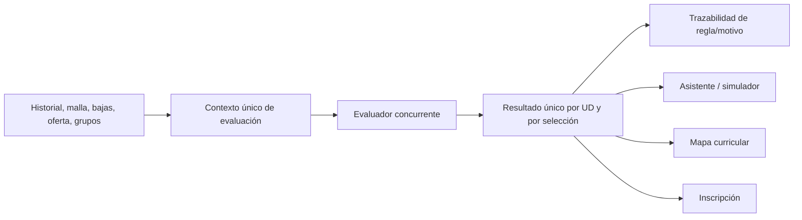

# Plan de implementación gradual de Reglas V2

Fecha: 2026-10-05  
Ámbito: **Mapa curricular dinámico**, **Asistente de inscripción y orientación educativa** y **motor V2**.  
Fuente funcional normativa: `documentacion/V2_REGLAS_VIGENTES.md`.  
Diagnóstico técnico de partida: `documentacion/MATRIZ_REGLA_CODIGO.md`.

## Decisiones de control

1. No se implementarán todas las reglas en un único cambio.
2. Las reglas **1.2, 1.3, 6.1 (criterios académicos), 6.6, 6.7, 6.8 y 9.3** permanecen sin nueva decisión funcional: la fuente las marca como **PENDIENTE DE VALIDACIÓN**. Sólo se prepararán contratos técnicos, trazabilidad y pruebas de caracterización.
3. La lógica actual de oferta, seriación, mapa y simulación se protegerá con pruebas de regresión antes de cambiar sus decisiones.
4. Cada resultado de evaluación deberá poder explicar: regla aplicada, datos usados, motivo, vigencia, resultado y si se aplicó una excepción tipificada.
5. Las modificaciones se activarán por configuración de vigencia y deberán ser reversibles sin reescribir historial académico.

## Arquitectura objetivo común

El contexto no sustituye las fuentes existentes: `InscripcionFacadeImpl` mantiene consulta de oferta e historial; `AsistenteInscripcionServiceImpl` mantiene diagnóstico y proyección; `MallaCurricularAlumnoBean` mantiene representación. El nuevo contrato evita que cada vista recalcule una regla con semántica distinta.

---

## FASE 0 — Fundamento técnico y regresión

### Objetivo

Normalizar estado/causa de cada UD, crear contexto y resultado únicos de evaluación, códigos de regla/motivo, trazabilidad, vigencia configurable y pruebas de caracterización del comportamiento actual. Esta fase no cambia la elegibilidad académica.

### Archivos/clases a modificar o crear

| Área | Archivos candidatos | Cambio técnico |
|---|---|---|
| DTO | `commons/dto/gestionescolar/v2/*`; nuevo `ContextoEvaluacionCurricularV2DTO`, `ResultadoEvaluacionCurricularV2DTO`, `DecisionUnidadCurricularV2DTO`, `TrazaReglaV2DTO` | Contrato único de entrada/salida; causa, regla, motivo, vigencia y evidencia. |
| Dominio | nuevo enum/DTO `EstadoUnidadCurricularV2`, `CausaPendienteUDV2`, `CodigoReglaV2`, `CodigoMotivoV2` | Separar acreditada, reprobada, no cursada, baja parcial, en curso, no inscrita y bloqueada. |
| Servicios | nueva interfaz/facade `EvaluacionCurricularV2Service`; adaptadores en `AsistenteInscripcionServiceImpl`, `InscripcionFacadeImpl` | Adaptar, no reemplazar aún, los datos actuales. |
| Mapa | `MallaCurricularAlumnoBean`, `MallaDiagramaNodoDTO` | Consumir estado normalizado sólo para comparación/diagnóstico, sin alterar visual final en esta fase. |
| Persistencia | entidades/repositorios `gestionescolar/v2`; scripts nuevos posteriores al último SQL vigente | Añadir tabla de evaluación/traza o columnas de versión/vigencia si el modelo actual no basta. |
| Configuración | catálogo/tabla de parámetros de reglas o configuración V2 | Fecha de inicio `2027-1`, versión de regla, activación por PE/proceso. |

### Base de datos propuesta

No modificar tablas históricas de inscripción para reinterpretarlas. Agregar, tras diseño revisado:

- catálogo de códigos de regla y motivos;
- tabla de ejecución/evaluación con persona, plan, periodo, semestre objetivo, versión de regla, fecha y resultado;
- detalle por UD con estado normalizado, causa de pendiente, fuente de datos, regla/motivo;
- relaciones con `tbl_caso_academico_operativo`/bitácora V2 cuando haya caso.

La decisión de nombres, FKs y retención requiere revisión del modelo actual. Migración aditiva y reversible; no migrar masivamente causas antiguas sin fuente confiable.

### Comportamiento

- **Anterior:** cada componente deriva parte del estado desde oferta, cursadas, reprobadas y bajas; las razones no siempre comparten un contrato persistible.
- **Nuevo:** se produce además una evaluación equivalente, observable y trazable; la UI continúa mostrando el resultado vigente actual hasta que una fase posterior active el nuevo evaluador.

### Pruebas

- Unitarias: mapeo de cada estado/causa; deduplicación por UD; serialización de resultado; vigencia desactivada; conservación de mensajes actuales.
- Integración: misma persona/periodo desde mapa, asistente e inscripción; comparación “antes/después” de oferta, bloqueos y conteos.
- Regresión: nuevo ingreso 4+2; regular/irregular actual; seriación directa; optativas; electivas; baja temporal/parcial conocida; sin oferta activa.

### Riesgo y rollback

Riesgo de clasificar erróneamente bajas/no cursadas como reprobadas. Mitigación: modo sombra, guardar fuente de cada dato y comparar contra salida actual. Rollback: desactivar bandera de evaluación V2 y dejar tablas nuevas sin consumidores; migración sólo aditiva.

---

## FASE 1 — Evaluación concurrente, Regla 2.2 y Regla 9.5

### Objetivo

Formalizar una evaluación previa concurrente y registrar su resultado, oferta individual, restricciones, excepciones y mensajes. Implementa infraestructura de **2.2** y **9.5**, sin alterar todavía reglas pendientes.

### Archivos/clases afectados

| Archivo/clase | Cambio |
|---|---|
| `EvaluacionCurricularV2Service` (nuevo) | Orquestar reglas activas concurrentes y devolver resultado por UD/selección. |
| `AsistenteInscripcionServiceImpl` | Solicitar resultado único para diagnóstico, escenarios, simulación y orientación. |
| `InscripcionFacadeImpl` | Crear evaluación previa antes de validar/finalizar; conservar validadores actuales como fuente de comparación. |
| C-05 (`Clasificador…`, `Diagnostico…`, `Recomendador…`, `ValidadorExpediente…`) | Asociar evaluación, patrón y dictamen sin duplicar reglas. |
| `TablaCurricularAsistidaBean` / vista | Mostrar explicación legible y conservar selección del usuario; no exponer códigos técnicos. |
| `MallaCurricularAlumnoBean` | Mostrar sólo causa/estado autorizados por resultado; no modificar criterios de color sin prueba. |

### Base de datos

Usar tablas Fase 0 para encabezado, detalle por UD y eventos; enlazar con `tbl_caso_diagnostico`, `tbl_caso_dictamen`, `tbl_caso_bitacora` y `tbl_caso_evidencia` cuando el expediente exista. Registrar huella de oferta (proceso, UD, grupo/cupo si corresponde), versión de regla y origen estudiante/gestor.

### Comportamiento

- **Anterior:** el asistente calcula contexto y el motor V2 puede producir caso/dictamen; la evaluación de oferta/restricción no queda necesariamente como una ejecución única recuperable.
- **Nuevo:** antes de simulación/validación se genera resultado concurrente. La inscripción seguirá usando sus validaciones vigentes hasta aceptación de equivalencia.

### Pruebas

- Unitarias: múltiples restricciones en una misma UD; prioridad sin ocultar causas; idempotencia de reevaluación; mensaje por perfil/periodo.
- Integración: evaluación desde estudiante y gestor; cambio de oferta entre evaluaciones; dictamen asociado; recuperación de bitácora.
- Auditoría: toda decisión debe contener código de regla, motivo, entrada resumida y timestamp.

### Riesgo y rollback

Riesgo de duplicar casos/evaluaciones o aumentar latencia. Mitigación: idempotencia por persona-plan-periodo-origen-huella de oferta y modo lectura. Rollback: deshabilitar persistencia/consumo de evaluación; no borrar trazas.

---

## FASE 2 — CTR-01: Control de Avance Anual exclusivo de quinto

### Objetivo

Desde `2027-1`, evaluar el Control de Avance Anual solamente cuando el **semestre objetivo sea 5**. No se implementan aún criterios académicos nuevos de 6.1 ni avance condicionado: se limita el ámbito de aplicación.

### Archivos/clases afectados

| Archivo/clase | Cambio |
|---|---|
| `InscripcionFacadeImpl` | Encapsular llamadas heredadas `obtenerMateriasPorAvanceAnualEstudianteRegular`, `…Irregulares` y `…SinTomarEnCuentaObligatorias` detrás de `aplicaControlAvanceAnual(contexto)`. |
| `AsistenteInscripcionServiceImpl` | Etiquetar la regla activa sólo cuando resultado indique objetivo 5/vigencia; proyecciones no deben convertir condición académica. |
| `EvaluacionCurricularV2Service` | Resolver vigencia y semestre objetivo; emitir `CTR-01` aplicó/no aplicó. |
| Repositorios/DTO de oferta | Asegurar que semestre objetivo provenga de plan/oferta, no de texto de UI. |
| Mapa/bean | Sólo consumir explicación, sin declarar bloqueo anual para 2→3 o 6→7. |

### Base de datos

Configuración versionada: `periodo_inicio=2027-1`, ámbito `semestre_objetivo=5`, estado activo. No eliminar parámetros de avance anual heredados hasta que pruebas de regresión concluyan.

### Comportamiento

- **Anterior:** funciones con nombre “avance anual” intervienen en flujos generales de oferta, especialmente para regulares/irregulares.
- **Nuevo:** antes de 2027-1 se conserva comportamiento configurado; desde 2027-1 sólo objetivo 5 activa el control. Seriación, carga y 6.4 siguen aplicando independientemente.

### Pruebas

- Unitarias: periodo 2026-2/2027-1; semestres objetivo 3,5,7; configuración ausente/inactiva.
- Integración: estudiante con pendiente obligatoria S2 para objetivo S3; pendiente S4 para S5; pendiente S6 para S7; verificar razones concurrentes.
- Regresión: métodos heredados reciben la bandera correcta y no eliminan optativas por un control no aplicable.

### Riesgo y rollback

Riesgo de abrir involuntariamente obligatorias por una interpretación incompleta de 6.1. Mitigación: esta fase sólo cambia el **ámbito**, no criterios; modo comparación y monitoreo. Rollback: desactivar configuración de vigencia y conservar adaptador heredado.

---

## FASE 3 — Reglas 5.2, 6.4 y 6.3

### Objetivo

Implementar la restricción severa de **4 o más UD reprobadas totales**, de cualquier tipo/año, y la prioridad automática de regularización, sin confundir baja/no cursada con reprobación.

### Archivos/clases afectados

| Archivo/clase | Cambio |
|---|---|
| `AsistenteInscripcionServiceImpl` | Revisar `calcularTotalReprobadasAcumuladas`, `calcularTotalReprobadasProyectadas`, escenarios y mensajes; basarse en causa normalizada y clave UD distinct. |
| `InscripcionFacadeImpl` | Revisar `obtenerMateriasReprobadas`, `marcarMateriasOfertadasReprobadas`, filtros y validación final; bloquear obligatorias nuevas con 6.4 y priorizar reprobadas ofertadas. |
| `EvaluacionCurricularV2Service` | Emitir 6.3 y 6.4 de forma concurrente y explicable. |
| Mapa | Exponer “reprobada” y “bloqueada por 6.4” como conceptos distintos; no cambiar estado histórico. |
| Repositorios | Confirmar contador por UD y tipo; evitar dobles filas bloque/participación. |

### Base de datos

No requiere reinterpretar calificaciones. Registrar en resultado normalizado el conjunto distinct de UD reprobadas, tipo, periodo y fuente. Si el historial no identifica causa, marcar `CAUSA_NO_DETERMINADA`, no contarlo automáticamente como reprobación.

### Comportamiento

- **Anterior:** hay umbral `TOTAL_REPROBADAS_RESTRICCION_SEVERA` y filtros de reprobadas; el alcance por tipo/año y la deduplicación deben verificarse.
- **Nuevo:** 4+ reprobadas totales activa 6.4; se bloquean obligatorias nuevas incluso del mismo año, se priorizan reprobadas ofertadas y sólo se completan optativas compatibles dentro de máximo irregular.

### Pruebas

- Unitarias: 3/4/5 reprobadas; obligatorias/optativas/electivas; duplicada B1/B2; misma UD con varios intentos; baja/no cursada.
- Integración: oferta contiene reprobadas y nuevas; oferta sin reprobadas; simulador/validador/inscripción/mapa entregan misma restricción.
- Regresión: 1–3 reprobadas no reciben bloqueo severo; seriación y CTR-01 concurren sin perder razones.

### Riesgo y rollback

Riesgo alto de restringir incorrectamente por datos duplicados o causas no normalizadas. Mitigación: Fase 0 obligatoria, conteo distinct, modo sombra y bitácora. Rollback: desactivar regla 6.4 V2 y mantener cálculo heredado sin eliminar resultados guardados.

---

## FASE 4 — Reglas 4, 4.1, 4.2 y 4.3: carga académica

### Objetivo

Aplicar carga semestral mínima 3, máxima 8 regular/6 irregular, excepciones de mínimo y prioridad ordenada: regularización → seriación → 6.4 → CTR-01 aplicable → optativas/electivas compatibles.

### Archivos/clases afectados

| Archivo/clase | Cambio |
|---|---|
| `InscripcionFacadeImpl` | Consolidar validación de carga antes de confirmar; reutilizar límites existentes; evitar validaciones divergentes por pantalla. |
| `AsistenteInscripcionServiceImpl` | Simulación, sugerencias y proyección consumen resultado único y expresan excepción de mínimo. |
| `TablaCurricularAsistidaBean` / `InscripcionBean` / vistas | Mantener selección del usuario; mostrar bloqueos/advertencias y carga resultante sin desmarcar indebidamente. |
| `EvaluacionCurricularV2Service` | Decidir rango, excepción, prioridad y razones de cada UD. |
| Configuración de carga | Verificar `tbl_max_min_planes` / DTO de límites y compatibilidad con parámetros V2. |

### Base de datos

Reusar límites de plan existentes; agregar sólo catálogo de motivo de excepción de mínimo y traza de cálculo. No codificar límites por vista.

### Comportamiento

- **Anterior:** C-01/C-02 validan selección y límites con reglas distribuidas; hay especialidades para nuevo ingreso y optativas.
- **Nuevo:** un resultado único determina elegibilidad y carga; la excepción bajo mínimo no habilita obligatorias prohibidas por 6.4, seriación o CTR-01 aplicable.

### Pruebas

- Unitarias: selección 1–9; regular/irregular; obligatorio insuficiente; sólo una UD elegible; optativa elegible/no elegible; nuevo ingreso 4+2.
- Integración: simulador vs validación vs inscripción final; selección preservada; mensaje en estudiante y gestor; carga semestral con B1/B2.
- Regresión: electivas, optativas opcionales y seriación no se degradan al aplicar mínimo/máximo.

### Riesgo y rollback

Riesgo de diferencia entre simulador e inscripción real. Mitigación: extraer un mismo servicio para ambas rutas y pruebas de contrato. Rollback: bandera por proceso para retornar al validador vigente; no eliminar el adaptador hasta equivalencia demostrada.

## Reglas expresamente fuera de decisión funcional

| Regla | Acción permitida en este plan | Acción prohibida hasta validación |
|---|---|---|
| 1.2, 1.3 | Normalizar causas, medir impacto, crear pruebas. | Redefinir formalmente Regular/Irregular o transición. |
| 6.1 criterios | Limitar ámbito por CTR-01 y trazar evaluaciones. | Definir compatibilidad, excepciones o avance condicionado. |
| 6.6, 6.7 | Modelar datos de baja y pruebas de caracterización. | Cambiar tratamiento académico de reincorporación. |
| 6.8 | Preparar proyección/recalculo y casos de prueba. | Habilitar continuidad non→par bajo criterio nuevo. |
| 9.3 | Preparar cálculo de créditos/seriación y pruebas. | Decidir habilitación final de S7/S8, seminario o electivas. |

## Criterios de salida entre fases

1. **Fase 0 → 1:** resultado normalizado y pruebas de regresión sin diferencias no explicadas.
2. **Fase 1 → 2:** trazabilidad visible para cada evaluación y bitácora idempotente.
3. **Fase 2 → 3:** CTR-01 probado por vigencia/semestre y aprobación funcional del alcance.
4. **Fase 3 → 4:** conteo 4+ confirmado con datos reales anonimizados y sin falsos positivos.
5. **Fase 4:** simulador, validador e inscripción comparten contrato y pruebas de integración aprobadas.

## Secuencia de despliegue propuesta

Cada fase se libera con migración aditiva, bandera desactivada, pruebas en desarrollo, validación en PRE, ventana de observación y activación por configuración. El rollback es de configuración y consumidor; las trazas se conservan para diagnóstico. No se requiere reescribir datos históricos para revertir.
